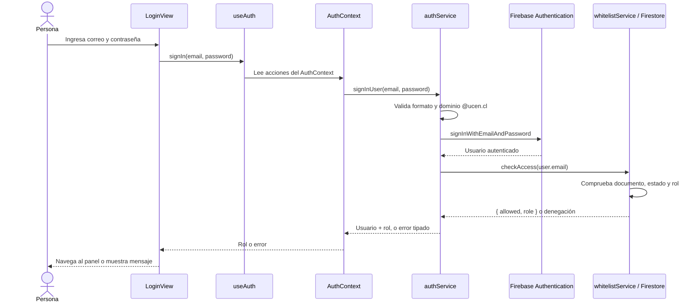

# Arquitectura de la landing page y el inicio de sesión

Material de apoyo para presentar a profesionales de desarrollo el flujo de entrada de ReflexIA, desde la página pública hasta la autorización por rol. Se enfoca en el código React + TypeScript, la navegación, el estado de autenticación y los límites entre frontend y backend.

## 1. Alcance funcional

El flujo comprende dos pantallas con responsabilidades diferentes:

- **Landing page (`/`)**: explica el propósito y el recorrido de ReflexIA; no requiere autenticación ni consulta servicios externos.
- **Inicio de sesión (`/iniciar-sesion`)**: permite que estudiantes, profesores guía y administradores se autentiquen con correo institucional y contraseña; el acceso efectivo depende también de su registro activo en la whitelist.

La identidad se comprueba con Firebase Authentication y la autorización por rol con Cloud Firestore. No se solicita RUT. La landing y el login son la entrada de la aplicación, no la frontera de seguridad: las reglas de Firestore y los controles de Firebase siguen siendo esenciales.

## 1.1 Alineación con la pauta EVA1

La EVA1 evalúa la aplicación completa en seis criterios. Este documento profundiza en la landing y el acceso, por lo que aporta evidencia directa para React/TypeScript, integración Firebase y diseño; no reemplaza la demostración de las demás funcionalidades comprometidas ni la verificación del repositorio.

| Criterio EVA1 | Evidencia concreta en landing/login | Qué demostrar o preparar para aspirar a «Logrado» |
|---|---|---|
| Funcionalidad y cumplimiento del alcance (30%) | `/` comunica el propósito y lleva al acceso; `/iniciar-sesion` valida el dominio, autentica, informa errores y redirige por rol. | Ejecutar en vivo el recorrido desde landing; comprobar una cuenta institucional activa de cada rol y un caso de acceso denegado. El alcance declarado debe coincidir con lo que efectivamente funciona. |
| React y TypeScript (20%) | React Router, componentes, props tipadas de `Button`, estado local y global, hooks integrados y tipos de autorización. | Explicar el flujo desde `LoginView` hasta los servicios; identificar dónde se usan `useState`, `useEffect`, `useContext`, `useMemo`, `useCallback` y por qué los tipos ayudan a controlar roles y estados. |
| Consumo de datos Firebase (15%) | Firebase Authentication valida credenciales; Firestore aporta el rol/estado de whitelist y notifica cambios mediante `onSnapshot`. | Mostrar el login real con una cuenta de prueba y la consulta de whitelist configurada para ese usuario. No presentar la landing como consumidora de Firebase: su contenido es estático. Distinguir autenticación de autorización y exhibir los estados de carga/error si se produce una falla controlada. |
| Diseño visual y responsividad (10%) | Composición responsive con Tailwind, tokens, fuentes locales, navegación semántica, foco visible y mensajes accesibles. | Abrir la landing y el formulario a ancho móvil (360 px) y escritorio; probar navegación con teclado y confirmar que no hay desbordamiento ni controles ilegibles. Las clases responsive son evidencia de implementación, pero la comprobación visual se debe hacer durante la demo. |
| Proceso de trabajo en GitHub (15%) | Este documento explica el código, pero no demuestra por sí mismo el estado del repositorio ni los commits individuales. | Antes de exponer, verificar que `main` sea la rama funcional, accesible y actualizada; comprobar que cada integrante tenga al menos 10 commits incrementales propios y descriptivos. No afirmar cantidades sin revisarlas en el repositorio. |
| Defensa oral (10%) | El mapa de archivos, el diagrama de secuencia, los límites de confianza y las observaciones de comportamiento sirven como base técnica. | Todos los integrantes deben poder explicar el flujo completo y justificar decisiones; preparar las preguntas de defensa incluidas al final y responder señalando los archivos correspondientes. |

Los niveles sugeridos por pauta son **Logrado (100% del criterio)**, **Logrado parcialmente (50%)** y **No logrado (0%)**. La demostración de estas dos pantallas solo acredita la evidencia indicada: por ejemplo, la integración Firebase de landing/login está circunscrita a autenticación y whitelist, mientras que otras funcionalidades Firebase de la aplicación deben mostrarse por separado.

**Nota para coordinación:** el DOCX de la pauta presenta una discrepancia sobre el tamaño del grupo: la portada indica 2–3 integrantes y la sección 2 indica 1–4. Confirmar el rango aplicable con el docente; también verificar que el grupo esté oficializado y sea distinto al de laboratorio.

### Lista de verificación previa para este flujo

- [ ] `main` es la rama que se ejecutará; se probó desde el código del repositorio con `npm run dev`.
- [ ] Las dependencias están instaladas y el servidor arranca sin errores. Ejecutar también `npm run lint` y `npm run build`.
- [ ] Hay cuentas de demostración para los roles que se van a mostrar, creadas en Firebase Authentication y registradas activas con el rol correcto en `whitelist`.
- [ ] Las cuentas y los datos usados son de prueba; no incluir contraseñas ni secretos en el repositorio, la presentación o el documento.
- [ ] Se ensayaron correo institucional válido, dominio no permitido, credenciales inválidas y autorización ausente/revocada, usando registros de prueba y sin alterar cuentas productivas.
- [ ] Se verificó el diseño en un viewport de 360 px y uno de escritorio, y se revisaron los estados de carga, error y navegación por teclado.
- [ ] Se revisó GitHub: rama `main` accesible y funcional, autoría/agrupación de cuentas comprobada y mínimo de 10 commits incrementales propios por integrante. `git shortlog -sn --no-merges main` sirve como resumen inicial; revisar el historial y la identidad de autor de cada integrante, no solo el total del grupo.
- [ ] Todos los integrantes conocen el recorrido de autenticación y pueden responder sobre código fuera de su contribución individual.

## 2. Mapa de código

| Archivo | Responsabilidad en este flujo |
|---|---|
| [`index.html`](../../index.html) | Declara idioma `es`, viewport, metadatos, título y el nodo `#root`. Carga `src/main.tsx`. |
| [`src/main.tsx`](../../src/main.tsx) | Arranca React; importa fuentes y estilos globales; monta `ErrorBoundary`, `BrowserRouter`, `AuthProvider` y `App`. |
| [`src/App.tsx`](../../src/App.tsx) | Declara las rutas públicas y protegidas. Carga vistas con `lazy` y proporciona el fallback de `Suspense`. |
| [`src/views/landingpage/LandingPage.tsx`](../../src/views/landingpage/LandingPage.tsx) | Presentación pública y enlaces hacia el login y secciones informativas. |
| [`src/views/auth/LoginView.tsx`](../../src/views/auth/LoginView.tsx) | Formulario controlado, validación de dominio, estados de carga/error y redirección al panel por rol. |
| [`src/hooks/useAuth.ts`](../../src/hooks/useAuth.ts) | API de lectura y acciones de autenticación para los componentes React. |
| [`src/context/AuthContext.tsx`](../../src/context/AuthContext.tsx) | Estado global `user`, `role`, `status`; escucha la sesión y cambios de autorización. |
| [`src/services/authService.ts`](../../src/services/authService.ts) | Orquesta validación de dominio, Firebase Authentication y comprobación de whitelist; normaliza errores. |
| [`src/services/whitelistService.ts`](../../src/services/whitelistService.ts) | Consulta y suscripción en tiempo real al documento de whitelist del usuario. |
| [`src/services/firebase.ts`](../../src/services/firebase.ts) | Inicializa Firebase una vez y exporta `firebaseAuth` y `firestoreDb`. |
| [`src/models/whitelist.ts`](../../src/models/whitelist.ts) | Contrato TypeScript para roles, estados y resultados de autorización; define `@ucen.cl`. |
| [`src/utils/institutionalEmail.ts`](../../src/utils/institutionalEmail.ts) | Normaliza y valida formato y dominio institucional. |
| [`src/components/RequireStudent.tsx`](../../src/components/RequireStudent.tsx) | Guarda de rutas: espera verificación, exige sesión y comprueba roles permitidos. |
| [`src/components/Button.tsx`](../../src/components/Button.tsx) | Botón compartido del formulario, con variante, tamaño y estado de carga tipados. |
| [`src/assets/styles/tokens.css`](../../src/assets/styles/tokens.css), [`tailwind.config.js`](../../tailwind.config.js) | Tokens visuales y extensiones de Tailwind usados por ambas pantallas. |
| [`firestore.rules`](../../firestore.rules) | Reglas del servidor que restringen lecturas y escrituras según identidad y rol. |

## 3. Estructura de arranque y navegación

```text
index.html (#root)
└── main.tsx
    └── StrictMode
        └── ErrorBoundary
            └── BrowserRouter
                └── AuthProvider
                    └── App
                        ├── /               → LandingPage (pública)
                        ├── /iniciar-sesion → LoginView (pública)
                        ├── /admin/*        → RequireStudent(admin) → AdminLayout
                        ├── /docente/*      → RequireStudent(teacher) → TeacherLayout
                        └── /estudiante/*   → RequireStudent(student) → StudentLayout
```

`AuthProvider` envuelve también las vistas públicas. Por eso, al visitar directamente el login, la aplicación ya está observando si existe una sesión de Firebase; `LoginView` puede redirigir a una persona que ya está autenticada sin pedirle que vuelva a ingresar sus credenciales.

En `App.tsx`, la landing y el login se cargan con `React.lazy`. El `Suspense` superior presenta un estado accesible (`role="status"`) mientras se descarga el módulo. La guarda `RequireStudent` se importa de forma normal para estar disponible al evaluar rutas privadas.

Las rutas de landing y login no tienen una guarda. Las rutas de panel sí. En rutas anidadas, el layout de rol contiene un `<Outlet />` donde React Router representa la vista hija.

## 4. Landing page: presentación y navegación pública

`LandingPage` es un componente de presentación sin estado de negocio:

- Los datos de los cuatro pasos del ciclo (`cycleSteps`) y los tres principios (`projectPrinciples`) son constantes del propio módulo.
- Los arreglos se convierten en elementos de interfaz con `.map()` y claves estables (`step.number`, `principle.title`).
- No usa `useAuth`, no invoca servicios y no obtiene contenido de Firestore. Su salida es predecible a partir de los datos estáticos.
- `Link` de React Router navega internamente sin recarga completa; los enlaces `href="#proyecto"` desplazan a la sección local identificada por `id="proyecto"`.
- `lucide-react` aporta iconos vectoriales decorativos, normalmente marcados con `aria-hidden="true"` cuando el texto adyacente ya comunica su significado.

### Composición visible

1. **Header**: marca ReflexIA, navegación al ancla «El proyecto» y llamada a «Explorar plataforma».
2. **Portada**: propuesta de valor, llamados a la acción y tarjeta que resume cuatro pasos.
3. **El proyecto**: tres principios de reflexión, acompañamiento y privacidad.
4. **Roles**: contenido para estudiantes y profesores guía. La acción de profesor enlaza a `/docente`, que es una ruta protegida.
5. **Llamado final y footer**: retorno al login e identificación del proyecto.

### Responsive y sistema visual

La composición se adapta mediante clases responsivas de Tailwind (`sm`, `md`, `lg`): una columna en pantallas pequeñas y dos columnas a partir de `md` en las áreas principales. El contenido usa anchuras máximas, padding adaptable y controles con alturas mínimas táctiles. La guía del producto requiere validar el resultado desde 360 px.

Los nombres de color (`bg-bg`, `text-primary`, `border-border`, `text-accent-ia`) y de fuente (`font-heading`) consumen extensiones configuradas en Tailwind. La paleta base incluye azul institucional, celeste/verde agua y esmeralda; Plus Jakarta Sans se usa para títulos e Inter para cuerpo. `main.tsx` importa las fuentes locales de `@fontsource`, evitando una dependencia de CDN de fuentes.

## 5. Formulario de autenticación

`LoginView` reúne la experiencia de autenticación para los tres perfiles. No se crean formularios separados por rol: el rol solo se conoce después de validar las credenciales y la autorización.

### Estado local y validación

El componente mantiene con `useState`:

- `email` y `password`: valores controlados por React.
- `error`: texto de error visible.
- `isSubmitting`: indica que la petición está en curso.

El dominio institucional se comparte como constante `INSTITUTIONAL_DOMAIN` desde el modelo. La validación inmediata de UI comprueba que el correo ingresado termine en `@ucen.cl`; también hay validaciones semánticas HTML (`type="email"`, `required`, `maxLength`, `autoComplete`, `inputMode`). Al enviar, `handleSubmit` ejecuta `preventDefault()`, bloquea el caso de dominio inválido y limpia el mensaje anterior.

Esta validación de interfaz mejora la experiencia, pero no es la autoridad final. `authService.signInUser` vuelve a validar el correo usando `validateInstitutionalEmail` antes de llamar a Firebase. Además, `whitelistService` valida el dominio al consultar y al gestionar registros.

### Envío, carga y errores

1. Se limpia el mensaje previo y `isSubmitting` pasa a `true`.
2. `useAuth().signIn(email, password)` realiza el flujo de autenticación.
3. Ante éxito, el rol determina la ruta y `navigate(..., { replace: true })` cambia de pantalla sin dejar el login en la pila inmediata de navegación.
4. Ante error, el `catch` traduce los códigos de `StudentAuthError` a mensajes en español. Los errores no tipados se registran con `console.error`.
5. `finally` restablece el estado de envío, tanto en éxito como en error.

Las credenciales incorrectas y el acceso no autorizado comparten un mensaje genérico. Esa decisión evita revelar desde la UI si una dirección está registrada. Los errores de disponibilidad ofrecen una explicación de conectividad y un botón para reintentar la verificación de autorización.

El botón usa el componente global [`Button`](../../src/components/Button.tsx), su estado `isLoading` y `fullWidth`; al cargar queda deshabilitado y presenta un indicador. Los mensajes tienen `role="alert"` y el formulario incluye etiquetas asociadas a los inputs mediante `htmlFor`/`id`.

### Redirección según el rol

La función local `getRoleRedirect` centraliza el mapeo:

| Rol de whitelist | Panel |
|---|---|
| `student` | `/estudiante` |
| `teacher` | `/docente` |
| `admin` | `/admin` |

Si `status === 'authenticated'` al entrar al login, se usa `<Navigate replace>` hacia el panel correspondiente. Así se cubre tanto la sesión ya restaurada por Firebase como el ingreso exitoso recién completado.

## 6. Flujo de autenticación, de UI a servicios



### Responsabilidades por capa

**`LoginView` (presentación y flujo de pantalla)**  
Controla inputs, feedback y navegación. No importa directamente Firebase ni ejecuta consultas a Firestore; consume el contrato de `useAuth`.

**`useAuth` (API de consumo React)**  
Lee `AuthContext` con `useContext`. Lanza un error explícito si se usa fuera de `AuthProvider`, haciendo visible una configuración incorrecta en lugar de devolver un estado simulado.

**`AuthContext` (estado compartido y ciclo de vida)**  
Mantiene `user`, `role` y un `status` discriminado: `loading`, `authenticated`, `unauthenticated` o `error`. Sus callbacks `signIn`, `signOut` y `retryAuthorization` forman la API que exponen los componentes. `useMemo` estabiliza el objeto de contexto; `useCallback` estabiliza las acciones.

Al montar, el efecto de `AuthProvider` se suscribe a `onAuthStateChanged`. Si hay un usuario de Firebase, verifica su acceso con `verifyUserAccess`; si la verificación falla por red/configuración, expone estado `error`. Si el acceso está revocado o no registrado, cierra la sesión. El efecto invalida respuestas antiguas mediante un contador de intentos y limpia tanto la suscripción de Firebase como la de whitelist al desmontarse o reintentarse.

**`authService` (caso de uso de autenticación)**  
`signInUser` valida el dominio, inicia sesión con Firebase Auth y solicita el rol al servicio de whitelist. Si la cuenta se autenticó pero no tiene autorización activa, cierra la sesión recién creada y lanza `StudentAuthError('unauthorized')`. Si Firestore no puede validar el acceso, también cierra la sesión y devuelve un error `unavailable`.

`StudentAuthError` usa códigos finitos (`invalid-email`, `invalid-credentials`, `unauthorized`, `unavailable`) para desacoplar la capa de servicio del texto español mostrado por la vista. Los errores de credenciales específicos que devuelve Firebase se normalizan a `invalid-credentials`.

**`whitelistService` (persistencia y autorización de negocio)**  
La colección `whitelist` tiene un documento por correo normalizado. `checkAccess` valida el dominio, busca el documento y devuelve `allowed: true` con el rol solo si está activo. La forma del resultado está tipada en `models/whitelist.ts`.

**`firebase.ts` (integración externa)**  
Inicializa/reutiliza una única aplicación Firebase y expone `firebaseAuth` y `firestoreDb`. Si la configuración no está disponible, exporta `null`; el contexto detecta ese estado y muestra error de servicio en vez de tratarlo como una sesión válida.

## 7. Restauración y revocación de una sesión

La comprobación de autorización no ocurre únicamente al enviar el formulario:

1. Firebase notifica la sesión actual al listener de `onAuthStateChanged`, incluido el caso de recarga.
2. `AuthContext` vuelve a consultar Firestore para derivar el rol desde la whitelist.
3. Si la cuenta está activa, el contexto registra `whitelistService.watchAccess`.
4. `watchAccess` usa `onSnapshot` sobre el documento de ese correo.
5. Si un administrador revoca el acceso, la notificación llega al cliente y se ejecuta el cierre de sesión. Si el rol cambia, se actualiza el rol en contexto.

Esto mantiene el estado de UI alineado con la whitelist mientras hay conexión. Una falla en el listener lleva a `status: 'error'` y deja disponible la acción de reintento.

## 8. Control de rutas y límites de confianza

`RequireStudent` usa `useAuth` y separa explícitamente los estados:

- `loading`: muestra «Verificando tu acceso…».
- `error`: informa que no pudo validar y ofrece reintento.
- sin sesión autenticada: redirige al login con `replace`.
- sesión con rol incorrecto: envía al panel propio del rol.
- sesión y rol admitidos: representa el layout protegido.

En `App.tsx`, la ruta `/admin` entrega `allowedRoles={['admin']}`, `/docente` entrega `['teacher']` y `/estudiante` usa el rol estudiante por defecto.

**Una guarda React no es una barrera de seguridad de datos.** El JavaScript del cliente puede inspeccionarse o alterarse. Las reglas de [`firestore.rules`](../../firestore.rules) verifican `request.auth`, identidad, rol y estado activo en el servidor para las operaciones sobre datos. Debe mantenerse la correspondencia entre los contratos del frontend, los documentos de Firestore y las reglas.

Las claves de configuración web de Firebase incluidas en una aplicación cliente no equivalen a credenciales de administrador. La protección real depende de Firebase Authentication, las reglas de Firestore y la configuración operativa; nunca deben colocarse secretos privados o credenciales de servicio en variables `VITE_*` ni en código distribuido al navegador.

## 9. Tipos y contrato de autorización

`models/whitelist.ts` evita repartir strings de rol sin control:

```ts
export const WHITELIST_ROLES = ['student', 'teacher', 'admin'] as const
export type WhitelistRole = (typeof WHITELIST_ROLES)[number]
export const INSTITUTIONAL_DOMAIN = '@ucen.cl'
```

El `as const` conserva los literales y permite derivar el tipo unión. Por ejemplo, la firma de `signIn` promete un `Promise<WhitelistRole>` y `getRoleRedirect` declara que recibe un rol de ese conjunto o `null`. Esto ayuda a detectar cambios incompletos —por ejemplo, agregar un rol sin actualizar su destino— en compilación.

`AccessCheckResult` es una unión discriminada: éxito con rol o denegación con motivo (`invalid-domain`, `not-registered`, `revoked`). Los datos procedentes de Firestore se validan en `parseEntry` antes de tratarlos como `WhitelistEntry`; no se confía ciegamente en el tipo estático frente a datos externos.

## 10. Temas de calidad para comentar

### Accesibilidad

- El documento establece `lang="es"` y `viewport`.
- Los campos tienen etiquetas explícitas, autocomplete apropiado y tipos nativos de entrada.
- Los errores y estados de verificación usan roles ARIA para lectores de pantalla.
- Los enlaces y controles implementan estilos de foco visible.
- Los iconos redundantes se ocultan a tecnologías asistivas.
- Conviene probar teclado, lectores de pantalla, contraste y reflow real además de inspeccionar las clases Tailwind.

### Privacidad y minimización

- El flujo de acceso usa correo institucional y contraseña; la interfaz declara que no solicita RUT.
- El mensaje genérico evita diferencias obvias entre credenciales inválidas y falta de autorización.
- La validación visual del dominio no debe confundirse con la autorización: solo una cuenta activa en la whitelist obtiene un rol.

### Rendimiento

- `lazy` reduce el JavaScript necesario para la carga inicial de vistas no visitadas; `Suspense` hace explícita la espera.
- La landing evita llamadas de red y puede renderizar su contenido a partir de constantes locales.
- Fuentes locales evitan depender de una descarga de tipografía desde un proveedor externo.

### Observaciones del comportamiento actual

1. `RequireStudent` incluye `state={{ from: location.pathname }}` al enviar una ruta privada al login; `LoginView` actualmente no consume ese `location.state`. Tras autenticarse se dirige al panel por rol, no necesariamente a la ruta privada que se intentó abrir.
2. La landing enlaza el CTA de profesor a `/docente`. Como es una ruta protegida, una persona sin sesión pasa por `RequireStudent` al login. Una cuenta autenticada con otro rol termina en su propio panel.
3. El formulario marca como inválido el dominio durante la escritura y bloquea el envío cuando termina el valor, pero la validación autoritativa vuelve a ejecutarse en `authService`.
4. La vista presenta el error de dominio con la clase `text-perf-fail`; la guía de diseño del proyecto reserva el rojo semántico para desempeño reprobado. Es una inconsistencia visual que conviene revisar en una iteración de UI, sin cambiar el contrato de autenticación.

## 11. Guion breve para presentar el código

1. Abrir `main.tsx` y explicar el montaje: el proveedor de autenticación queda por encima de todo el router.
2. Abrir `App.tsx`: distinguir rutas públicas y rutas por rol, y mostrar `lazy`/`Suspense`.
3. Recorrer `LandingPage.tsx`: contenido estático y CTAs internos, sin dependencias de backend.
4. Abrir `LoginView.tsx`: inputs controlados, validación rápida, estado de envío, feedback accesible y destino por rol.
5. Seguir `useAuth` → `AuthContext` → `authService` → `whitelistService`: separar interfaz, sesión Firebase y autorización institucional.
6. Mostrar `RequireStudent` y las reglas de Firestore para explicar que la autorización de cliente es UX; el servidor aplica permisos.
7. Cerrar mostrando la suscripción en tiempo real que cierra una sesión cuando se revoca el acceso.

### Frase de resumen

> La landing comunica el producto sin depender de datos remotos; el login inicia una identidad con Firebase y el backend de Firestore determina si esa identidad está autorizada y cuál es su rol. React mantiene el estado compartido y adapta la navegación, pero no sustituye las reglas de seguridad del servidor.

### Recorrido EVA1 recomendado para estas pantallas

Dentro del bloque de demostración funcional de 10–13 minutos, reservar aproximadamente 2–3 minutos a landing/login; dejar tiempo suficiente para las otras funcionalidades comprometidas de la aplicación:

1. **Landing (30–45 s):** presentar el usuario objetivo y la necesidad que aborda ReflexIA; señalar que esta pantalla es pública y de contenido estático.
2. **Login (60–90 s):** mostrar validación de dominio, estado de carga, ingreso con una cuenta de prueba y redirección al panel según su rol. Si el tiempo lo permite, mostrar brevemente el error genérico con credenciales no válidas y recuperar el flujo normal.
3. **Integración Firebase (30–45 s):** señalar el documento de whitelist asociado a la cuenta de prueba; explicar que Firebase Auth acredita identidad y Firestore autoriza acceso y devuelve el rol. Evitar editar o revocar cuentas productivas durante la exposición.
4. **Diseño adaptable (30–45 s):** usar las herramientas del navegador para mostrar landing y login a 360 px y escritorio; comprobar foco de teclado y que los textos/controles sigan siendo utilizables.

La pauta distribuye el total de 15–20 minutos de manera referencial: 1–2 minutos para alcance, 10–13 para la demo funcional y 5–7 para preguntas. Coordinar turnos para que todos participen; la distribución del tiempo puede ajustarse según la cantidad de integrantes y las indicaciones docentes.

### Preguntas de defensa oral para ensayar

- **¿Qué diferencia hay entre autenticar y autorizar?** Firebase Authentication valida la identidad y credenciales; la whitelist de Firestore determina si el correo está activo y qué rol tiene.
- **¿Por qué el rol no es un campo que el usuario elige en el formulario?** El cliente obtiene el rol desde el documento de whitelist después de autenticar; las reglas de Firestore vuelven a comprobar en servidor el rol y el estado activo para cada operación protegida.
- **¿Dónde se comparte el usuario entre rutas?** `AuthProvider` en `main.tsx` expone el contexto; `useAuth` lo consume sin prop drilling.
- **¿Qué hacen los hooks en este flujo?** `useState` administra campos/feedback; `useEffect` sincroniza sesión y suscripciones; `useContext` lee el estado global; `useMemo` y `useCallback` estabilizan el valor y las acciones.
- **¿Qué ocurre si Firestore no responde después de autenticar?** El servicio cierra la sesión si no puede autorizar, devuelve un error de disponibilidad y la UI ofrece reintento; no asume un rol por defecto.
- **¿La ruta protegida basta para proteger los datos?** No. Es control de navegación del cliente; las reglas de Firestore son las que deben denegar operaciones no autorizadas en servidor.
- **¿La landing consulta datos reales?** No; su contenido es estático. En este flujo, el uso real de Firebase corresponde al login, la whitelist y su escucha en tiempo real.
- **¿Cómo se comprueba la adaptación móvil?** En un viewport de 360 px y uno de escritorio, verificando layout, interacción, foco y ausencia de scroll horizontal inesperado.
- **¿Cómo prueban el proceso de trabajo?** Revisando que `main` sea ejecutable y accesible, y el historial para comprobar al menos 10 commits incrementales y descriptivos por cada integrante.

## 12. Lecturas complementarias

- [`guia-presentacion.md`](./guia-presentacion.md): orden de la exposición y recorrido general por historias de usuario.
- [`HU08_GUIA.md`](../historias-usuario/HU08_GUIA.md): configuración y decisiones del flujo multi-rol.
- [`AI_GUIDELINES.md`](../../AI_GUIDELINES.md): requisitos funcionales, identidad visual y reglas de arquitectura del frontend.
